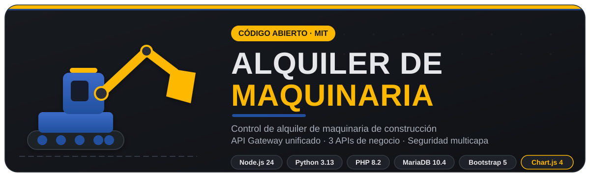
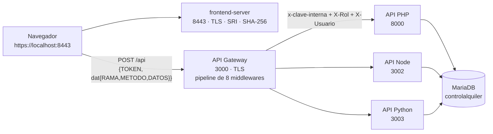

<div align="center">



# Control de Alquiler de Maquinaria de Construcción

**Sistema full-stack de alquiler de maquinaria de construcción** con un API Gateway unificado,
**3 APIs de negocio** (Node.js, Python, PHP) y una arquitectura de **seguridad multicapa**.

[](LICENSE)
[](#c%C3%B3digo-abierto)
[](#tecnolog%C3%ADas-y-lenguajes)
[](#c%C3%B3mo-empezar)

<p align="center">
  <b>Español</b> · Este proyecto es y seguirá siendo de <b>código abierto</b> bajo la licencia <a href="LICENSE"><b>MIT</b></a>.
</p>

</div>

---

## ¿Qué es este proyecto?

Es un **sistema de gestión y alquiler de maquinaria de construcción** construido como proyecto
académico y llevado a un sistema real de **6 piezas desacopladas**. Cubre el ciclo completo del
negocio: catálogo público con fotos reales, solicitudes de alquiler con aprobación/rechazo,
alquileres, devoluciones con inspección técnica, unidades por máquina con estados (disponible /
alquilada / mantenimiento / baja), reportes vivos sobre datos reales, notificaciones operativas
y administración de usuarios.

Su rasgo distintivo es el **contrato de aplicación**: el frontend no habla nunca directamente
con las APIs — habla con **un único API Gateway** al que le envía un sobre JSON que declara
`{RAMA, METODO, DATOS}`. El Gateway ejecuta la cadena de seguridad de 8 etapas, autentica el
token, verifica los permisos por rol y reenvía la petición a la API interna responsable.
Ninguna API conoce usuarios ni toma decisiones de seguridad por sí misma: solo confía en su
Gateway.

```text
Navegador  →  Gateway (3000)  →  API Node (3002) | API Python (3003) | API PHP (8000)  →  MariaDB
            │                    alquileres         catálogo / unidades   sesiones / captcha
            │                    solicitudes        fotos / reportes      clientes / bitácora
            └── frontend-server (8443): sirve la web con integridad SHA-256 + SRI + CSP
```

## Características

- **Catálogo público y privado** con foto real por cada tipo de maquinaria, galería por máquina
  en modal (foto 1 a 10), filtros por categoría y disponibilidad, orden, búsqueda y paginación.
- **Ciclo de negocio completo**: solicitud → aprobación → alquiler → devolución con inspección
  y estado final de la unidad.
- **Unidades por máquina** (por serial) con control de estado para el detalle de cada alquiler.
- **Reportes** calculados sobre datos vivos, con resumen inmediato y guardado de reportes.
- **Notificaciones operativas** con marcado individual y "marcar todas".
- **Gestión de usuarios de extremo a extremo**: roles (`admin` / `operador`), captcha obligatorio
  en cada login, cambio de clave forzado al primer acceso, bitácora de acciones.
- **Seguridad por capas**: 14 defensas documentadas en [`docs/SEGURIDAD.md`](docs/SEGURIDAD.md).
- **Integridad verificable**: el frontend se sirve con huellas SHA-256 de sus 154 archivos
  (`integridad.json`) y SRI en los vendors; una alteración en disco no se sirve y queda
  registrada en `logs/seguridad.log`.
- **App móvil (demo)**: prototipo React Native + Expo que consume el mismo Gateway, incluido
  como **código fuente** sin compilar ([`movil/`](movil)).

## Arquitectura

Las 6 piezas, todas atadas a `127.0.0.1` y sin lógica de negocio repetida:

| Pieza | Puerto | Servidor | Responsabilidad |
|---|---:|---|---|
| **Frontend (web)** | 8443 HTTPS | `frontend-server/server.js` (Node nativo) | Sitio estático con integridad SHA-256, SRI y CSP estricta |
| **API Gateway** | 3000 HTTPS | `api-gateway` (Express) | Única puerta: sobre `{TOKEN, dat{RAMA, METODO, DATOS}}` |
| **API PHP** | 8000 | `apis/apiphp/enrutador.php` | Usuarios, sesiones, clientes, captcha, bitácora |
| **API Node** | 3002 | `apis/apinode/servidor.js` (Express) | Alquileres, devoluciones, solicitudes, notificaciones |
| **API Python** | 3003 | `apis/apipython/servidor.py` (FastAPI) | Maquinarias, unidades, fotos, reportes |
| **MariaDB** | 3306 | XAMPP | BD `controlalquiler` (InnoDB, utf8mb4_unicode_ci) |



### El contrato del Gateway

Una sola petición para todo el sistema (POST a `https://localhost:3000/api`):

```json
{
  "TOKEN": "<JWT o cadena vacía en rutas públicas>",
  "dat": {
    "RAMA": "MAQUINARIAS",
    "METODO": "GET",
    "DATOS": { "id": 1 }
  }
}
```

Y la respuesta siempre conserva el mismo sobre en todo el sistema:

```json
{ "ok": true, "codigo": 200, "mensaje": "Listado generado.", "datos": [ ... ] }
```

### Mapa de ramas (qué atiende cada API)

| RAMA | Métodos | API interna |
|---|---|---|
| `USUARIOS` | POST (login), PUT (cambiar clave), PATCH (clave-admin) | PHP 8000 |
| `CUENTAS` | GET (lista), POST (crear) — **solo admin** | PHP 8000 |
| `CLIENTES` | GET (lista / detalle / búsqueda / paginado), POST | PHP 8000 |
| `CAPTCHA` | POST (generar) | PHP 8000 |
| `ALQUILERES` | GET (lista / detalle), POST (crear) | Node 3002 |
| `DEVOLUCION` | GET / PUT (devolver con inspección) | Node 3002 |
| `SOLICITUDES` | GET, POST, PUT (aprobar / rechazar) | Node 3002 |
| `NOTIFICACIONES` | GET, PUT (leída / todas) | Node 3002 |
| `MAQUINARIAS` | GET, POST, PATCH, DELETE | Python 3003 |
| `UNIDADES` | POST (por máquina), PUT (estado) | Python 3003 |
| `FOTOS` | POST (carga de foto por carpeta) | Python 3003 |
| `REPORTES` | GET (guardados), POST (resumen / guardar), DELETE | Python 3003 |

Rutas públicas sin token: `MAQUINARIAS:GET`, `SOLICITUDES:POST`, `USUARIOS:POST` y
`CAPTCHA:POST` (todo lo demás exige JWT vigente y rol con permiso).

Detalle completo de la arquitectura, las 8 etapas del pipeline y decisiones de diseño:
[`docs/ARQUITECTURA.md`](docs/ARQUITECTURA.md).

## Seguridad (resumen)

La seguridad está diseñada por capas; el detalle completo está en
[`docs/SEGURIDAD.md`](docs/SEGURIDAD.md). Las 14 defensas:

1. **Punto de entrada único**: las 3 APIs internas solo escuchan en `127.0.0.1` y exigen el
   encabezado `x-clave-interna`; nadie puede saltarse el Gateway (ni siquiera `localhost`).
2. **Bloqueo de Host forjado / DNS rebinding** en el Gateway (responde `421`).
3. **CORS con lista exacta de orígenes** (`ORIGEN_FRONTEND` del `.env` del Gateway).
4. **Verificación de origen por petición**: además de CORS se valida el `Origin`/`Referer`
   exacto contra la lista permitida (403 si no coincide o viene vacío).
5. **TLS 1.2+** con certificado local auto-generado (se renueva en cada instalación).
6. **Rate limits por IP** (en memoria): 100 req/min general · 5 fallos de login/15 min ·
   15 captchas/5 min · 20 fotos/15 min, con cabecera `Retry-After`.
7. **Captcha obligatorio en cada login** (API PHP): id con `random_bytes(16)`, de un solo uso,
   con expiración y cuota adicional por IP de captchas activos (429).
8. **Bloqueo de cuenta por intentos fallidos** + cambio de clave forzado al primer acceso.
9. **JWT solo en memoria** del navegador (nunca en `localStorage`): firma **HS256**, issuer y
   audience exigidos, expiración de **15 minutos**, y solo hay dos roles (`admin` /
   `operador`) con matriz de permisos `RAMA:METODO` (admin `*`; `CUENTAS` reservada al admin).
10. **Contraseñas con bcrypt** (`password_hash`/`password_verify` de PHP): nunca en claro.
11. **Consultas parametrizadas** en las 3 APIs (mysqli `bind_param`, mysql2 `?`,
    mysql-connector `prepared=True`).
12. **Esquema SQL con CHECK** y claves foráneas; base `utf8mb4_unicode_ci`.
13. **Frontend blindado**: el servidor carga los archivos en memoria y verifica SHA-256 contra
    `integridad.json` antes de servir (los alterados no se sirven hasta reiniciar), más **SRI
    (sha384)** en `vendor/` y **CSP estricta** con `default-src 'none'`.
14. **Cabeceras de respuesta** en Gateway y frontend-server: `X-Content-Type-Options`,
    `X-Frame-Options: DENY`, `Referrer-Policy: no-referrer`, `Permissions-Policy`,
    `Cross-Origin-Opener/Resource-Policy`, `HSTS` y `Cache-Control: no-store`.

## Tecnologías y lenguajes

| Lenguaje | Dónde se usa |
|---|---|
| **JavaScript (Node.js 24)** | Gateway (`api-gateway`), API Node (`apis/apinode`), frontend-server |
| **JavaScript (navegador)** | Módulos del frontend (`frontend/js`) — ES2017+, sin frameworks |
| **Python 3.13** | API de catálogo (`apis/apipython` — FastAPI + Uvicorn) |
| **PHP 8.2** | API de sesiones/captcha (`apis/apiphp`) |
| **SQL** | Esquema y semillas (`basededatos/esquema.sql`) — MariaDB 10.4 |
| **CSS / HTML** | Sistema de diseño (`frontend/css/estilos.css`, `index.html`) + Bootstrap 5.3 |

Librerías principales: **Express 4** (gateway y API Node), **FastAPI 0.115** (API Python),
**mysql2 3.9 / mysql-connector 9.1**, **jsonwebtoken 9**, **Bootstrap 5.3.3 + Bootstrap
Icons 1.13**, **Chart.js 4.4.7** y **FullCalendar 6.1.15** (locales en `vendor/`, con SRI).
Versiones completas: [`REQUERIMIENTOS.txt`](REQUERIMIENTOS.txt).

## Cómo empezar

### 1. Requisitos

- Windows 10/11 x64 + **PowerShell 7** (`winget install Microsoft.PowerShell`)
- XAMPP con **PHP 8.2** y **MariaDB 10.4** activos
- **Node.js 24** y **Python 3.13** en PATH
- Lista completa: [`REQUERIMIENTOS.txt`](REQUERIMIENTOS.txt)

### 2. Arrancar

```powershell
.\iniciar.bat
```

En el **primer arranque** el sistema es autogestivo y crea todo por sí mismo:

- genera el `.env` de cada pieza con **claves aleatorias** (nunca hay claves en el repo),
- genera el **certificado TLS local** (RSA 2048, 1 año) y lo confía en tu almacén de Windows,
- crea la BD `controlalquiler` (InnoDB/utf8mb4) con datos de siembra y la **contraseña inicial
  del admin**, generada al azar y guardada **hasheada con bcrypt** — la contraseña en texto
  queda en `basededatos/.admin-inicial.env` (se exige cambiarla en el primer login),
- deja las 6 piezas vivas y corre checks de salud contra cada servicio.

Después abre **https://localhost:8443** e ingresa con la contraseña inicial del `admin`.

### 3. Detener / verificar / herramientas

```powershell
.\detener.bat                     # libera los puertos del proyecto (MariaDB se respeta)
.\scripts\verificar.ps1           # estado de salud de la pila completa
.\scripts\generar-integridad.ps1  # regenerar huellas tras cambiar archivos del frontend
```

> **Integridad**: si editas archivos de `frontend/`, corre `generar-integridad.ps1`. El
> frontend-server no sirve archivos alterados hasta reiniciar con el manifiesto nuevo.

### 4. Demo móvil

`movil/` contiene el **prototipo React Native + Expo** como **código fuente sin compilar**.
Para probarla (opcional):

```bash
cd movil && npm install && npx expo start
```

Ajusta `URL_GATEWAY` en `App.js` según tu entorno (Expo Web / emulador Android / teléfono).

## Estructura del proyecto

```text
├─ api-gateway/          # Gateway único (Express): seguridad + enrutamiento por RAMA
│  └─ src/               # config, 8 middlewares, controller, router
├─ apis/
│  ├─ apinode/           # API de alquileres/solicitudes/notificaciones (Express + mysql2)
│  ├─ apipython/         # API de catálogo/unidades/reportes (FastAPI) + fotos
│  └─ apiphp/            # API de sesiones/captcha/clientes (mysqli preparada)
├─ basededatos/          # esquema.sql (13 tablas InnoDB/utf8mb4) + semillas
├─ frontend/             # index.html + módulos js + vendor con SRI + img
├─ frontend-server/      # server.js: HTTPS + integridad SHA-256 + gzip + CSP
├─ certificados/         # TLS local — generado por iniciar.ps1 (excluido del repo)
├─ docs/                 # banner.svg, ARQUITECTURA.md, SEGURIDAD.md, evidencias
├─ movil/                # demo React Native/Expo (código fuente, sin compilar)
├─ scripts/              # iniciar / detener / verificar / generar-integridad (.ps1)
├─ integridad.json       # huellas SHA-256 de los 154 archivos servidos
├─ iniciar.bat           # 1) libera puertos · 2) levanta las 6 piezas
└─ detener.bat           # detiene solo los procesos del proyecto
```

## Base de datos

13 tablas InnoDB con claves foráneas y `CHECK` (`utf8mb4_unicode_ci`): `usuarios`, `clientes`,
`maquinarias` (+ `maquinariaspesadas` / `maquinariaslivianas`), `unidades`, `solicitudes`,
`alquileres`, `inspecciones`, `notificaciones`, `reportesguardados`, `captchas`,
`bitacoraacciones`.

Las máquinas del catálogo viven en `maquinarias` con su campo `carpeta`, que conecta cada
registro con su galería en `frontend/img/maquinaria/<carpeta>/`.

## Código abierto

Este proyecto es **de código abierto** y está publicado bajo la licencia **MIT** — puedes
usarlo, estudiarlo, modificarlo y redistribuirlo libremente, conservando el aviso de licencia.
Ver [`LICENSE`](LICENSE).

## Créditos

Proyecto académico (Anexo D) desarrollado en la **Universidad Cooperativa de Colombia** y
elevado a sistema referencial local. Mantenido por
[MartinEscudero771](https://github.com/MartinEscudero771).

---

<div align="center">

<b>Frontend sin frameworks (vanilla JS), backend por piezas pequeñas y seguridad en profundidad.</b><br/>
© 2026 — Autores del proyecto · Licencia <b>MIT</b>

</div>
