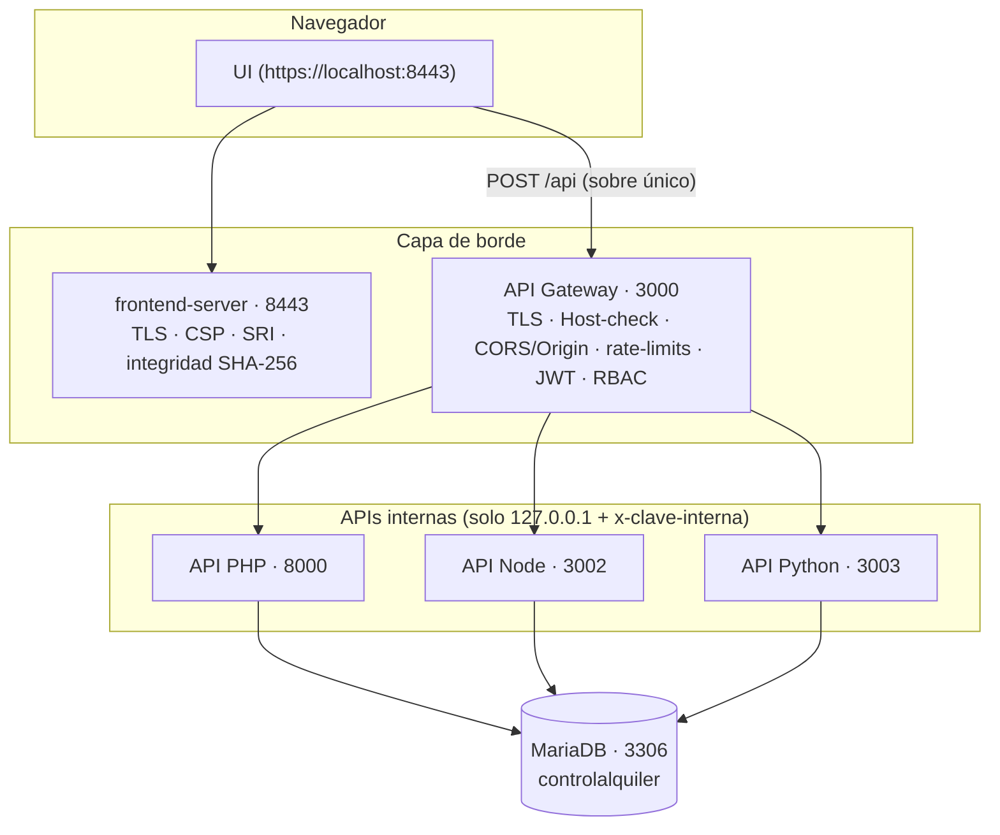

# Arquitectura

Este documento explica cómo funciona el sistema completo: piezas, puertos, contratos de
comunicación, el pipeline de seguridad del Gateway y las decisiones de diseño.

## Visión general

El sistema se compone de **6 piezas** desacopladas que solo se hablan entre sí por HTTPS/HTTP
local, siempre en `127.0.0.1`:

| # | Pieza | Carpeta | Puerto | Tecnología | Qué es |
|---|---|---|---:|---|---|
| 1 | Frontend web | `frontend/` + `frontend-server/` | 8443 (HTTPS) | HTML/CSS/JS vanilla + Node nativo | La interfaz de usuario; su servidor la sirve con integridad verificada |
| 2 | API Gateway | `api-gateway/` | 3000 (HTTPS) | Node + Express | Única puerta de entrada del sistema |
| 3 | API PHP | `apis/apiphp/` | 8000 (HTTP local) | PHP 8.2 con mysqli | Sesión/usuarios, clientes, captcha y bitácora |
| 4 | API Node | `apis/apinode/` | 3002 (HTTP local) | Node + Express + mysql2 | Alquileres, devoluciones, solicitudes y notificaciones |
| 5 | API Python | `apis/apipython/` | 3003 (HTTP local) | Python + FastAPI | Catálogo de maquinarias, unidades, fotos y reportes |
| 6 | Base de datos | `basededatos/` | 3306 | MariaDB 10.4 (XAMPP) | BD `controlalquiler` (13 tablas InnoDB, utf8mb4) |



**Regla de oro:** existe un solo camino hacia los datos — el navegador entra por 8443 (web),
y toda operación de datos entra por 3000 (Gateway). Las APIs de negocio no están publicadas:
escuchan en loopback y exigen la clave interna de su Gateway (`x-clave-interna`).

## El contrato de aplicación

Toda operación del sistema es una **única petición** al Gateway:

```http
POST https://localhost:3000/api
Content-Type: application/json

{ "TOKEN": "<JWT>", "dat": { "RAMA": "ALQUILERES", "METODO": "POST", "DATOS": {...} } }
```

- `TOKEN` = JWT del usuario o cadena vacía en rutas públicas.
- `RAMA` = área del dominio (una tabla/familia, p. ej. `MAQUINARIAS`).
- `METODO` = acción (`GET`, `POST`, `PUT`, `PATCH`, `DELETE`).
- `DATOS` = carga útil (filtros, campos, ids).

La respuesta es siempre el mismo sobre:

```json
{ "ok": true, "codigo": 200, "mensaje": "…", "datos": [ … ] }
```

Ventajas del diseño: la seguridad vive en un solo lugar (el Gateway), el frontend y el móvil
consumen **el mismo contrato**, y cada API queda libre de la lógica de enrutamiento y de la
seguridad de borde — se puede reescribir una API en otro lenguaje sin tocar el resto.

## Las ramas del sistema

El Gateway traduce cada `RAMA:METODO` a **una sola API interna y una sola ruta HTTP** (mapa
cerrado, implacable con lo desconocido):

| RAMA | Metodos | API | Verificación extra |
|---|---|---|---|
| `USUARIOS` POST / PUT / PATCH | login / cambiar clave / clave-admin | PHP | rate-limit de login + captcha |
| `CUENTAS` GET / POST | listar y crear usuarios | PHP | **solo rol admin** |
| `CLIENTES` GET / POST | catálogo de clientes | PHP | token |
| `CAPTCHA` POST | generar captcha | PHP | rate-limit propio |
| `ALQUILERES` GET / POST | listado/detalle/crear | Node | token |
| `DEVOLUCION` GET / PUT | caso de devolución | Node | token |
| `SOLICITUDES` GET / POST / PUT | flujo de aprobación | Node | token |
| `NOTIFICACIONES` GET / PUT | avisos y marcado de lectura | Node | token |
| `MAQUINARIAS` GET / POST / PATCH / DELETE | catálogo público y ABM | Python | GET público; resto token |
| `UNIDADES` POST / PUT | unidades por máquina + cambio de estado | Python | token |
| `FOTOS` POST | cargar foto por carpeta | Python | rate-limit de fotos + token |
| `REPORTES` GET / POST / DELETE | resumen y guardado de reportes | Python | GET público; resto token |

## Pipeline del Gateway: 8 etapas

Cada petición a `POST /api` recorre esta cadena (`api-gateway/src/routes/api.js`):

1. **`controlAcceso`** — valida IP de loopback, identifica la petición por `Origin`/`Referer`
   exacto y la compara contra la lista de orígenes permitidos. Sin origen válido → `403`.
2. **`limiteGeneral`** — rate limit global de **100 peticiones/minuto/IP** (429 + `Retry-After`).
3. **`validarEstructura`** — el sobre `{TOKEN, dat}` debe venir bien formado y acotado
   (tipos, tamaños, JSON ≤ 1 MB). Lo inválido se rechaza genérico y temprano.
4. **`verificarBloqueoLogin`** — si la rama es `USUARIOS:POST`, corta la IP que acumule
   **5 fallos en 15 minutos** (ventana rodante en memoria).
5. **`limiteFotos`** — ramas de carga de imagen limitadas a **20/15 min/IP**.
6. **`limiteCaptcha`** — generación de captcha limitada a **15/5 min/IP** (la API PHP agrega
   además una cuota de captchas activos por IP).
7. **`autenticar`** — decide si la rama es pública (sin token) o protegida; cuando hay token lo
   verifica con `jsonwebtoken`: **HS256**, `issuer` y `audience` exigidos y expiración 15 min.
8. **`autorizar`** — matriz de permisos por rol (`admin: *`, `operador`: 21 acciones con
   token; `CUENTAS` reservada al admin). Sin permiso → `403`.

Solo después de las 8 etapas el `gateway.controller` consulta el map de `RAMA+METODO`, añade
las cabeceras internas (`x-clave-interna`, `X-Rol`, `X-Usuario`) y reenvía con timeout de
10 s (a `504`/`502` si el backend no responde). El Gateway nunca encadena APIs ni aplica
lógica de negocio.

## Frontend-server (8443)

`frontend-server/server.js` es un servidor HTTPS estático (Node nativo, sin dependencias):

- **TLS 1.2 mínimo** con el certificado local `certificados/local.pfx` (lo genera
  `scripts/iniciar.ps1` con `New-SelfSignedCertificate`; se renueva si falta).
- **Integridad**: arranca leyendo `integridad.json` (huellas SHA-256 de 154 archivos) y sirve
  **desde memoria**; si un archivo cambia en disco, lo detecta, deja de servirlo y registra
  el incidente en `logs/seguridad.log` hasta reiniciar con manifiesto nuevo
  (`scripts/generar-integridad.ps1`).
- **CSP estricta** `default-src 'none'` + excepciones exigidas (`script/style/css/font/media/img`,
  `connect-src` apuntando únicamente al Gateway).
- **SRI** en cada librería de `frontend/vendor/` (`integrity="sha384-…"` en `index.html`).
- **Caché inteligente**: `no-store` para el HTML y `no-cache` + **ETag** (revalidación) para
  el resto; gzip en memoria para textos grandes.
- Cabeceras: `nosniff`, `X-Frame-Options`, `Referrer-Policy`, `Permissions-Policy`,
  `HSTS`, `COOP/CORP`.

## Base de datos

`controlalquiler` — MariaDB/XAMPP — InnoDB — `utf8mb4_unicode_ci`:

- **Catalogo**: `maquinarias` (con vínculo `carpeta` a su galería de fotos),
  `maquinariaspesadas` (peso/movilización) y `maquinariaslivianas` (ancho/aptitud urbana),
  `unidades` por serial con estado.
- **Negocio**: `solicitudes` (aprob/rechazo con contexto), `alquileres` (con cliente, fechas y
  valores), `inspecciones` (salida y regreso), `clientes`.
- **Operación**: `notificaciones` (avisos por nivel con leído), `reportesguardados`.
- **Seguridad**: `usuarios` (roles, hash bcrypt, intentos_fallidos, debe_cambiar_clave),
  `captchas` (id, ip, expira, usado), `bitacoraacciones` (auditoría de cada acción).

El seeding (`esquema.sql`) es idempotente (`INSERT IGNORE`) y se refresca con
`scripts/iniciar.ps1`.

## App móvil (Anexo D)

`movil/` contiene el prototipo **React Native + Expo** publicado como **código fuente sin
compilar**. Al igual que la web, consume **solamente** el Gateway (mismas ramas, mismo sobre
con `TOKEN: ''` para las rutas públicas del catálogo). Para ejecutarlo: `npm install &&
npx expo start` y ajustar `URL_GATEWAY` en `App.js`.

## Integración continua del estilo de diseño

La paleta del frontend vive en `frontend/css/estilos.css` (fondo `#14161A`, texto `#E5E7EB`,
gris `#A8AEB8`, amarillo `#FFB800`, acero `#214F9E`) y el **banner del repo**
(`docs/banner.svg`) usa exactamente esa paleta.
